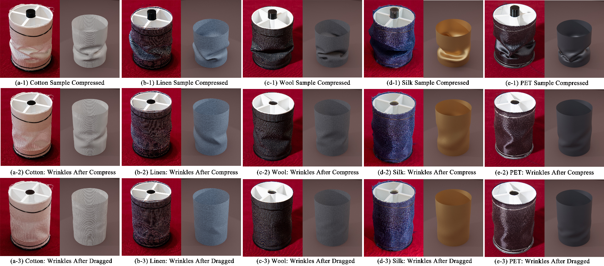
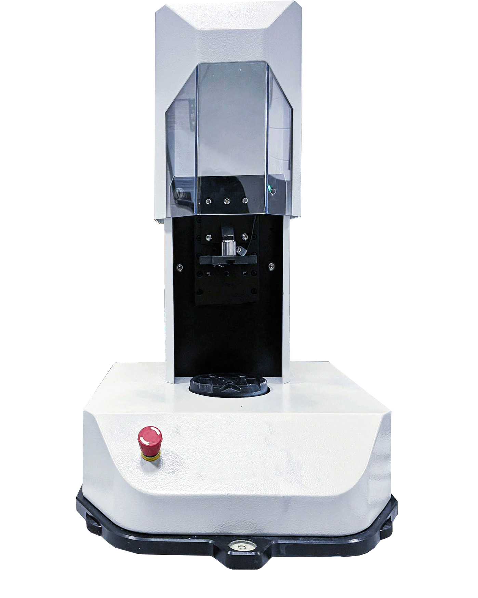
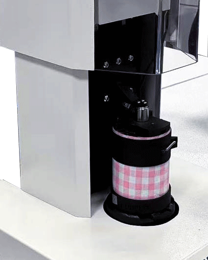
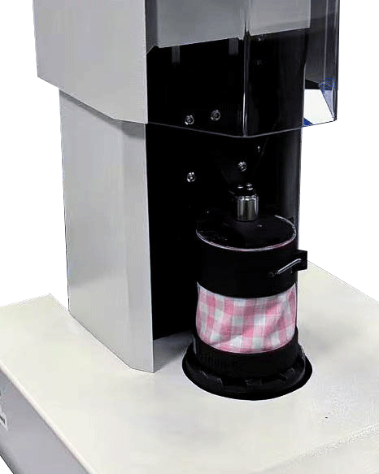
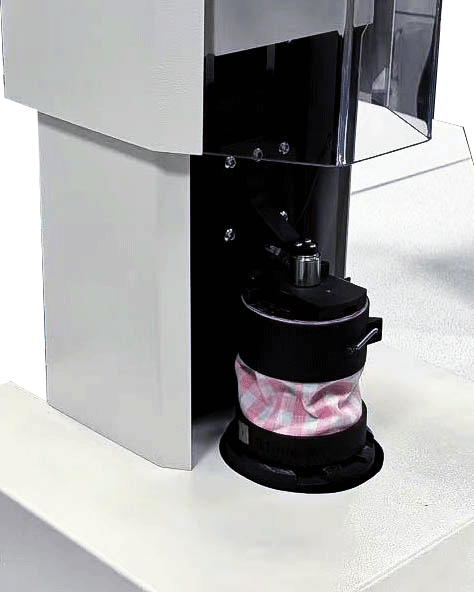
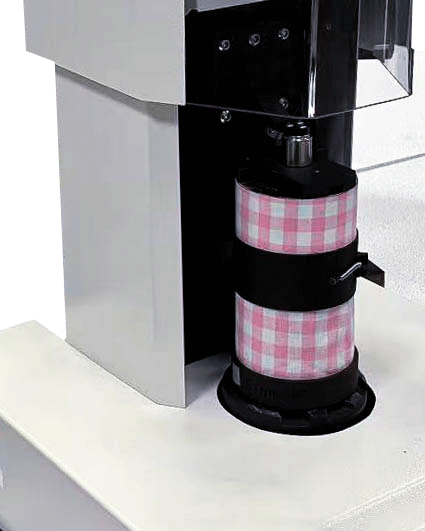

<div align="center">

# Fabric-101 & Learnable Persistent Wrinkles

**Fabric measurements, microscopy images, and tools for studying persistent wrinkles and learning cloth material parameters.**

[](https://asia.siggraph.org/2026/)
[](https://arxiv.org/abs/2609.13707)



*Real and simulated persistent wrinkles in different fabrics.*

</div>

## Overview

This repository accompanies:

> **Learnable Persistent Wrinkle Formation in Cloth Simulation**  
> Deshan Gong, Ningtao Mao, Xiaoyuan Yang, Xinyu Lu, He Wang, Taku Komura  
> SIGGRAPH Asia 2026 · [Paper](https://arxiv.org/abs/2609.13707)

Fabric-101 provides fabric measurements and microscopy images for studying
material behavior. Our simulation model combines internal friction and plasticity
to fit measured loading–unloading behavior and reproduce persistent wrinkles.

The repository includes raw measurements, microscopy images, data-processing
scripts, the simulation backend in `libuipc-diff/`, and parameter-training tools
in `training/`.

[Browse fabrics](FABRICS.md) · [Download catalog CSV](fabric_catalog.csv)

## Testing instrument

The measurements in this dataset were collected using the **Leeds University
Fabric Handle Evaluation System (LUFHES)**, developed at the University of Leeds
under the leadership of Professor Ningtao Mao. LUFHES applies a series of
mechanical tests to quantify fabric tactile behavior. Our measurements include
compression, twisting, and drag/stretch loading, with force–displacement and
torque–rotation curves used to characterize cloth response and hysteresis.

For the instrument design and measurement method, see Ningtao Mao and
Mark Taylor, *Evaluation apparatus and method*, international patent
application publication [WO 2012/104627 A2](https://patents.google.com/patent/WO2012104627A2/en),
University of Leeds, published 9 August 2012.

### Instrument and test setup

The photographs show the instrument, a mounted specimen, and the tests in
measurement order: twist, compression, then stretch.

| LUFHES | Mounted fabric | Twist | Compression | Stretch |
| :---: | :---: | :---: | :---: | :---: |
|  |  |  |  |  |

## Repository structure

```text
Fabric_101_for_Wrinkles/
├── data/                 # Raw measurement files and test settings
│   └── Cotton/
│       └── 001/          # Test/session index
│           ├── head.dat
│           ├── warp/
│           │   ├── s1/   # Specimen index
│           │   │   ├── tarevalues.csv
│           │   │   ├── compression/compression.dat
│           │   │   ├── friction/friction.dat
│           │   │   └── twist/twist.dat
│           │   ├── s2/
│           │   └── s3/
│           └── weft/
├── photos/               # Microscopy images by material
│   ├── Cotton/
│   ├── Linen/
│   ├── Wool/
│   ├── PET/
│   └── Silk/
├── libuipc-diff/          # Simulation backend source and Python bindings
├── scripts/
│   ├── compress_twist.py # Compression and twist processing
│   └── friction.py       # Stretch loading-curve processing
├── training/             # Interactive and batch parameter fitting
│   ├── stretch/
│   ├── shear/
│   └── bending/
│       ├── isotropic/
│       └── orthotropic/
├── processed_data/       # Processed example curves (NumPy)
├── plots/                # Saved plots
├── assets/               # README illustrations
├── FABRICS.md            # Category-sorted fabric information
└── fabric_catalog.csv    # Fabric properties (CSV)
```

Keep the raw directory structure intact: the scripts
construct paths from material, session, direction, and specimen names.

The five principal example materials used in our paper are:

| Material | Raw-data directory | Photo directory |
|---|---|---|
| Cotton | `data/Cotton/` | `photos/Cotton/` |
| Linen | `data/Linen/` | `photos/Linen/` |
| Wool | `data/Wool/` | `photos/Wool/` |
| PET | `data/PET/` | `photos/PET/` |
| Silk | `data/Silk/` | `photos/Silk/` |

## Fabric catalog

Browse the [fabric catalog](FABRICS.md) or download the
[CSV](fabric_catalog.csv). The catalog lists 103 fabric IDs, including paper,
grouped by category and sorted by fabric ID.

| CSV field | Description |
|---|---|
| `fabric_id` | Fabric ID |
| `category` | Material category |
| `name` | English name |
| `thickness_mm` | Thickness (mm) |
| `areal_density_g_m2` | Areal density (g/m^2, gsm) |

## Raw measurement files

The `.dat` files contain test settings and measurements. `head.dat` contains
material and session information; `tarevalues.csv` contains the recorded tare
values. Keep these files with their measurement folders.

| File | Processing entry point | Processed curve axes |
|---|---|---|
| `compression.dat` | `compress_twist.py`, `test_type = "compression"` | Compression displacement (mm), force (N) |
| `twist.dat` | `compress_twist.py`, `test_type = "twist"` | Rotation angle (degrees), torque (N·m) |
| `friction.dat` | `friction.py` | Drag/stretch displacement (mm), load force (N) |

`friction.dat` contains the drag/stretch test. The processing script extracts
its initial tensile loading curve for stretch training.

### Session selection for specific records

Use the sessions below for records that were retested. The folder paths refer
to the acquisition data, not the microscopy photographs.

| Data folder | Session selection |
| --- | --- |
| `data/E-C02/` | Drag/stretch: 003. Compression/twist: warp 001, weft 002. |
| `data/E-F02/` | Drag/stretch: 004. Compression/twist: 003. |
| `data/E-KN07/` | Use 001. |
| `data/E-N02/` | Drag/stretch: 007. Compression/twist: 006. |
| `data/EX-11/` | Drag/stretch: 005. Twist: 004. Compression: warp 002, weft 003. |
| `data/Paper 1/` | Compression/twist: 002. Drag/stretch: 003. |
| `data/S01/` | Use 004 for warp twist. Other records were flagged as problematic. |
| `data/S05/` | Weft was retested in 002; weft twist in 001 was flagged as problematic. |
| `data/S08/` | Warp was retested in 002; warp records in 001 were flagged as problematic. |

## Microscopy photographs

`photos/` contains microscope photographs taken at different magnification
settings.

**Image orientation:**

- **Vertical: warp.**
- **Horizontal: weft.**

## Process the measurements

### Requirements

Use Python with NumPy, SciPy, and Matplotlib:

```bash
python -m pip install numpy scipy matplotlib
```

Run the scripts from the repository root:

```bash
python scripts/compress_twist.py
python scripts/friction.py
```

The scripts use settings near the top of each file rather than command-line
arguments. Set the material, session, direction, and test type before running.
If a variable has multiple active assignments, the last assignment takes effect;
leave only the intended selection active.

### Compression or twisting

In `scripts/compress_twist.py`, select, for example:

```python
fabric_name = "Cotton"
test_idx = "001"
test_direction = "warp"       # "warp" or "weft"
test_type = "compression"     # "compression" or "twist"
PLOT_TYPE = "AVG"             # "AVG" or "ALL"
CANCEL_TARE = False
IS_SAVE_PLOT = False
```

By default, the script reads `s1`, `s2`, and `s3`. For materials with fewer
specimens, update `FILE_PATHS` and `TARE_VALUE_PATH` to include only the available
specimens. The script separates loading and unloading, smooths and resamples
each segment, and averages the selected specimens. In `AVG` mode, it writes:

```text
processed_data/<fabric_name>_<direction>_<test_type>.npy
```

Use `PLOT_TYPE = "ALL"` to inspect individual curves. `SELECTED_SAMPLE` controls
which specimens are displayed in that mode; the averaging inputs are set by
`FILE_PATHS` and `TARE_VALUE_PATH`.

### Friction/stretch loading data

In `scripts/friction.py`, select the material, session, direction, and specimen
paths in `FILE_PATH`. The script writes the extracted loading curve to:

```text
processed_data/<fabric_name>_<direction>_friction.npy
```

### Outputs

Figures are displayed with Matplotlib. Processed curves are saved under
`processed_data/`; files with the same name are overwritten. `IS_SAVE_PLOT`
controls plot saving in `compress_twist.py`, separately from NumPy export.

### Read a processed curve

Each exported `.npy` array has shape `(2, N)`: row 0 is displacement or rotation,
and row 1 is force (N) or torque (N m). Displacement is in mm and rotation is
in degrees.

```python
from pathlib import Path
import numpy as np
import matplotlib.pyplot as plt

path = Path("processed_data/Cotton_weft_twist.npy")
curve = np.load(path, allow_pickle=False)
assert curve.ndim == 2 and curve.shape[0] == 2

angle_deg, torque_nm = curve
plt.plot(angle_deg, torque_nm)
plt.xlabel("Rotation angle (degrees)")
plt.ylabel("Torque (N·m)")
plt.show()
```

## Building and installing the simulation backend

Follow the [Windows build and installation guide](https://spirimirror.github.io/libuipc-doc/build_install/windows/),
using the bundled [`libuipc-diff/`](libuipc-diff) as the source directory.

### Tested Windows environments

| Component | RTX 3070 Ti laptop | RTX 5070 Ti desktop | RTX 5090 desktop |
|---|---|---|---|
| Operating system | Windows, x64 | Windows, x64 | Windows, x64 |
| GPU | NVIDIA GeForce RTX 3070 Ti Laptop GPU | NVIDIA GeForce RTX 5070 Ti | NVIDIA GeForce RTX 5090 |
| NVIDIA driver | 617.14 | 617.14 | 616.64 |
| CUDA Toolkit used for the build | 12.4, `nvcc` 12.4.99 | 12.8, `nvcc` 12.8.61 | 12.9 Update 1, `nvcc` 12.9.86 |
| Visual Studio | Visual Studio 2022 Community | Visual Studio 2022 Professional | Visual Studio 2022 Professional |
| MSVC toolset | v143 (`14.43.34808`) | v143 (`14.43.34808`) | v143 (`14.44.35207`) |
| CMake used for configuration | 3.31.6 | 4.0.0 | 4.2.1 |
| Python | Conda Python 3.13.2, x64 | Conda Python 3.11.17, x64 | Conda Python 3.11.18, x64 |
| pybind11 installed in the Python environment | 2.13.6 | 3.1.0 | 3.1.0 |

Compilation succeeded with the CUDA/MSVC combinations listed in the table.

## Parameter training

After installing the backend, install the frontend dependencies in the same
Python environment:

```powershell
python -m pip install numpy torch polyscope matplotlib
```

The training scripts open a Polyscope window. Select the data, set the material
properties and optimizer settings, click **Apply settings and reset**, then
**optim**. The exact reset-button label varies by workflow.

The window shows loss, parameters, epoch time, and predicted curves against
ground truth (GT). Select historical epochs to compare curves.
**Pause optimization** pauses between epochs.

**Save training records** is on by default; turning it off makes the panel dark
red. Bending best parameters are saved even when detailed logging is off.
GUI records do not include Adam state for resuming training.

Density inputs use **kg/m^3** and thickness inputs use **m**. Convert catalog
areal density to volumetric density using
`density = areal_density_g_m2 / (1000 * thickness_m)`.

### Stretch

From the repository root:

```powershell
cd training/stretch
python stretch_model.py
```

This fits the axial stretching stiffness (`K22` in simulation coordinates).
The default target is Cotton weft. Choose a supplied dataset or enter a custom
NumPy path, then set density, thickness, initial stiffness, learning rate, and
epoch limit. Enter density and thickness for the selected material.

The target array must have shape `(2, 31)`: 31 uniformly spaced, strictly
increasing displacements in mm, starting at zero, and corresponding forces in N.
The simulation performs 30 steps over that displacement range.

Adam optimizes `U`, with physical stiffness `P = U^2`. The learning rate therefore
controls the update in `U`. **Run & Stop** runs a forward simulation.

Records are saved to `training/stretch/logs/gui_training_<timestamp>/`, including
settings, per-epoch loss and curves, `best_result.npz`, and a summary. When saving
is off, those epochs are omitted. 

### Shear

The shear model uses the original imposed-angle stiffness correction in Python.
Run `python train.py` from `training/shear`. Training uses two stages:

| Stage | Loss frames (inclusive) | Trainable parameters |
| --- | --- | --- |
| 1 | 0–40 | `k33_0`, `k33_1`, friction stiffness, threshold |
| 2 | 0–60 | All six, including hardening and yield |

Targets require at least 61 angle/torque samples, following
`0 -> 5 -> 0 -> 5` degrees over the first 61 samples (20 steps per branch).

Stage 2 starts from the stage-1 best parameters and resets Adam. Set learning
rates and epoch limits in the panel. Each stage runs for up to 500 epochs, with
plateau early stopping.

Batch example, from `training/shear`:

```powershell
python train.py --headless-train --fabric 59_Cotton --direction warp --epochs 500
```

The epoch limit applies to each stage. Records are stored under
`logs/gui_staged_<timestamp>/stage1` and `stage2`. The stage-2 best parameters are
restored at completion. 

### Isotropic bending

From the repository root:

```powershell
cd training/bending/isotropic
python train.py
```

This compression workflow uses the supplied slit mesh and fixed stretching/shear
parameters. **Activate bending plasticity (isotropic)** is on by default.
With plasticity on, training proceeds as follows:

| Stage | Initialization | Trainable parameters | Loss frames (inclusive) |
| --- | --- | --- | --- |
| 1: warp | Configured initial values | Stiffness, friction stiffness, threshold | 30–70 |
| 2: warp | Stage-1 best; reset Adam | All five, including hardening and yield | 30–70 and 120–150 |
| 3: weft | Stage-2 warp best; reset Adam | All five | 30–70 and 120–150 |

With plasticity off, all stages optimize only the first three parameters;
hardening is fixed at 50 and yield at 100. The selected mode is saved with the
best parameters for orthotropic initialization.

Stages 2 and 3 simulate continuously to frame 150 and evaluate loss on the 72
selected frames. Set initial parameters, individual learning rates, solver
tolerances, and collision options in the panel. Each stage runs for up to 100
epochs, with plateau early stopping. Shear sliding and plasticity are inactive.

Records are saved under `logs/gui_bending_<timestamp>/`. Best parameters and
curves are saved after each improved forward evaluation, including when detailed
logging is off. Interrupted runs retain their previously saved bests. Keep the
entire run folder for orthotropic training.

Batch examples, from the isotropic folder:

```powershell
python train.py --headless-train --fabric 59_Cotton --epochs 500
python train.py --headless-train --fabric 59_Cotton --epochs 500 --no-plastic
```

The epoch limit applies to each stage. 

### Orthotropic joint bending

Complete the isotropic warp and weft stages first. From the repository root:

```powershell
cd training/bending/orthotropic
python train.py
```

Enter the isotropic run folder and click **Load isotropic warp and weft bests**.
Both best records must come from the same run, with the same plasticity setting.
Keep `run_manifest.json` and its referenced best files together. The original
target data and matching mesh must remain available.
Missing, incompatible, or damaged records produce an error.

Plasticity follows the isotropic log: when on, all ten directional parameters
are optimized; when off, only six stiffness/friction parameters are optimized,
with hardening fixed at 50 and yield at 100 in both directions.

Training minimizes the mean warp/weft MSE using frames 30–70 and 120–150,
with up to 100 epochs and plateau early stopping. Set individual learning rates
and solver options in the panel. Collision is on by default, and additional
history gradients are off.

Results are saved under `logs/gui_joint_<timestamp>/`. Best paired parameters
and curves are saved even when detailed logging is off. Closing the window
also stops its simulation processes.

Batch example, from the orthotropic folder:

```powershell
python train.py --headless-train --isotropic-run "<isotropic run folder>" --epochs 500
```


## License

Original project software contributions are licensed under **AGPL-3.0-only**
([LICENSE](LICENSE)). Project-provided research data, microscopy photographs,
processed curves, and the fabric catalog are licensed under **CC BY-NC 4.0**
([LICENSE-DATA](LICENSE-DATA)): noncommercial use with attribution.

The data restriction does not apply to the software. Upstream and third-party
code retains its existing licenses. See [LICENSING.md](LICENSING.md) for scope
and [THIRD_PARTY_NOTICES.md](THIRD_PARTY_NOTICES.md) for dependency notices,
including the bundled NVTX terms that still require redistribution review.
