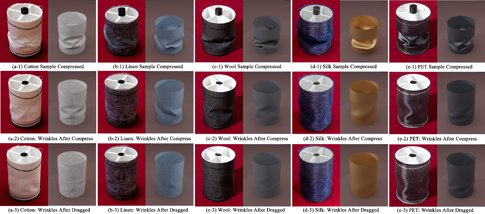
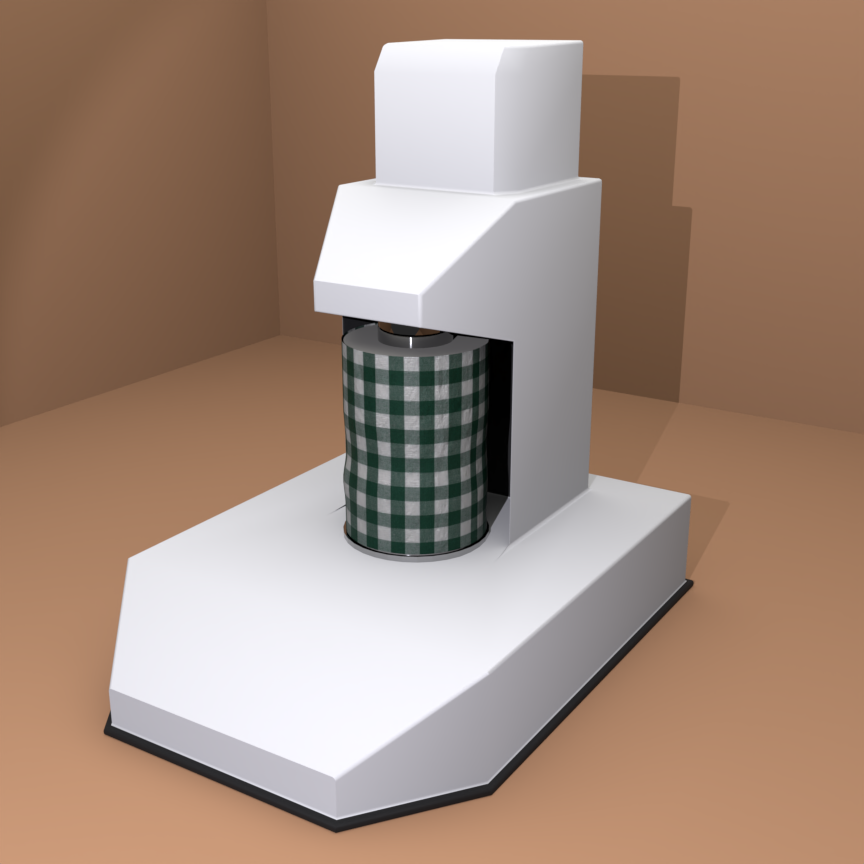
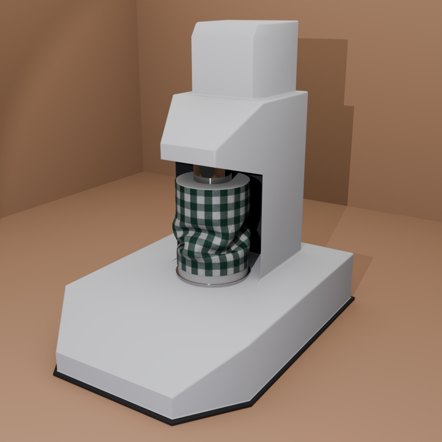
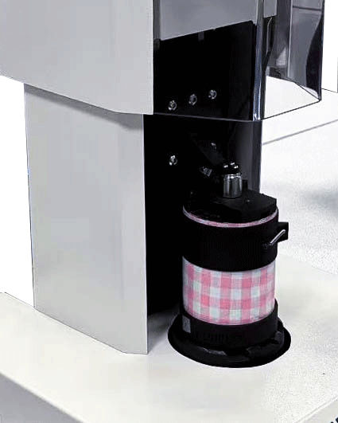
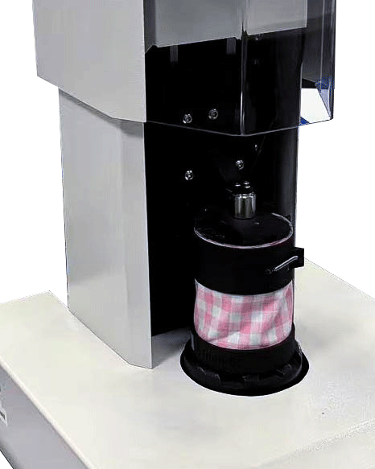
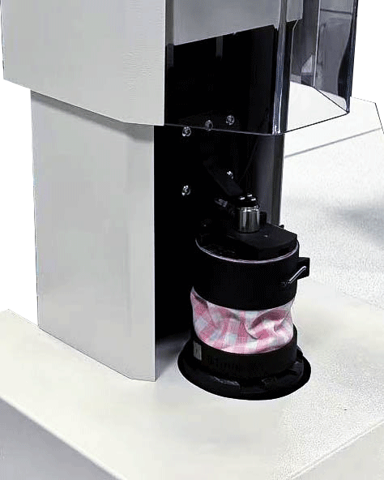
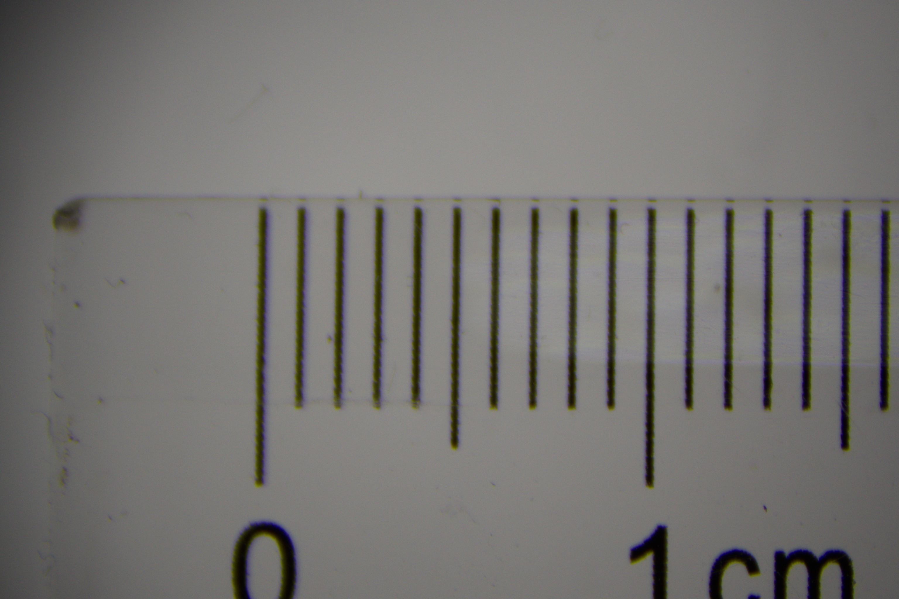
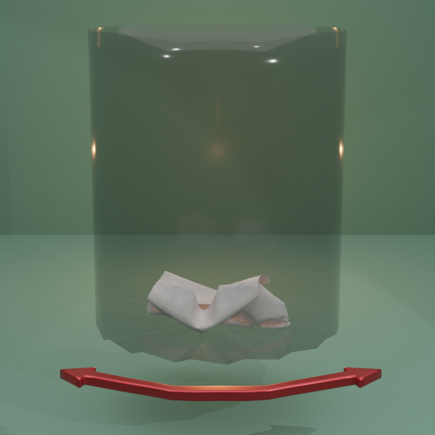
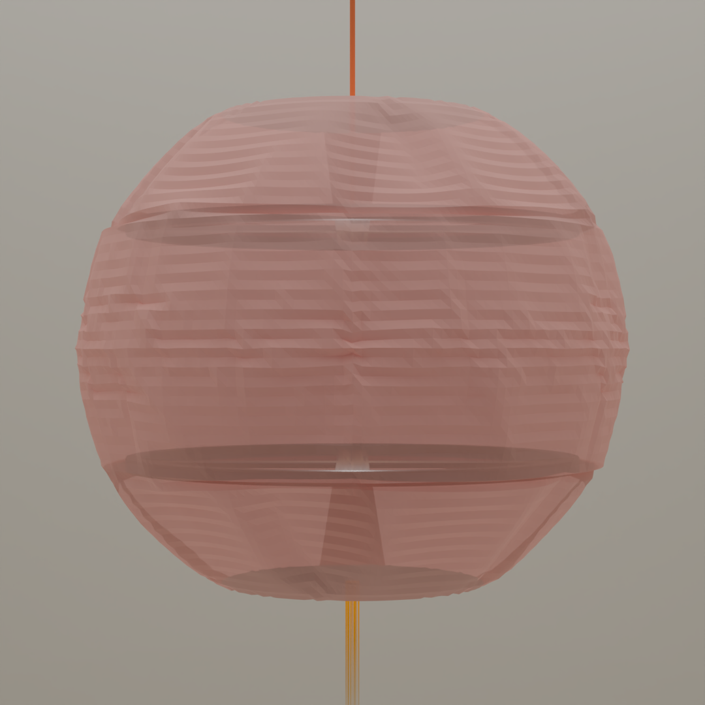
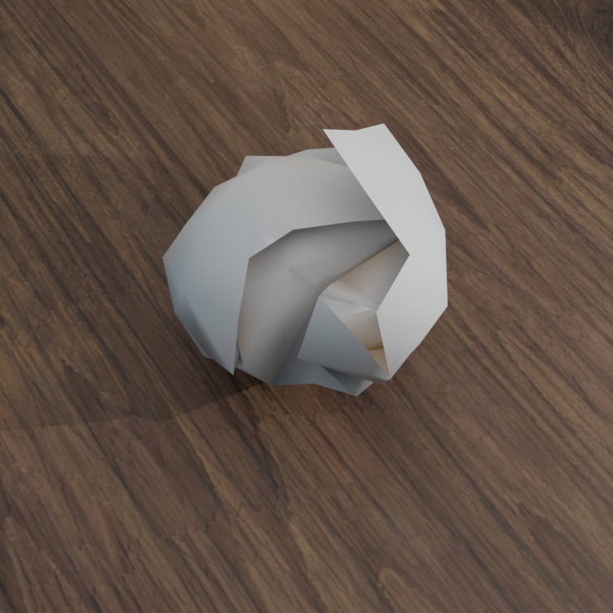

<div align="center">

# Fabric-101 & Learnable Persistent Wrinkles

**Fabric measurements, microscopy images, and tools for studying persistent wrinkles and learning cloth material parameters.**

[](https://asia.siggraph.org/2026/)
[](https://arxiv.org/abs/2609.13707)



*Real and simulated persistent wrinkles in different fabrics.*

The fixture shown above is available as [3D-printable OBJ models](assets/Teaser_3D_Print).

</div>

## Overview

This repository accompanies:

> **Learnable Persistent Wrinkle Formation in Cloth Simulation**  
> Deshan Gong, Ningtao Mao, Xiaoyuan Yang, Xinyu Lu, He Wang, Taku Komura  
> SIGGRAPH Asia 2026 · [Paper](https://arxiv.org/abs/2609.13707)

Fabric-101 provides fabric measurements and microscopy images for studying
material behavior. Our simulation model combines internal friction and plasticity
to fit measured loading–unloading behavior and reproduce persistent wrinkles.

The repository includes raw measurements, microscopy images, data-processing
scripts, the simulation backend in `libuipc-diff/`, and parameter-training tools
in `training/`.

[Browse fabrics](FABRICS.md) · [Download catalog CSV](fabric_catalog.csv)

The differentiable simulator is based on the [**uipc**](https://github.com/spiriMirror/libuipc).

# Known Issues & Problems to Solve


- Under axial compression, thin-shell buckling can lead to different equilibrium shapes and variations in the predicted net force. Tighter Newton solver tolerances can reduce numerical variation in some cases, at the cost of longer simulation times, but do not guarantee a unique deformation path.
- After fixing some bugs, some parameters, e.g., initialization and learning rate, are different from our paper. Please use our default parameters in the code to train.
- Our tests cover moderate deformations, with limited data at larger deformations.
- Fitting bending plasticity from compression curves alone can lead to unrealistically sharp residual wrinkles in simulations of wrinkle-resistant fabrics such as wool and silk.
- Fabric viscosity is omitted in our current work.
- Some fabric data have errors. I will test them again.

## Testing instrument

The measurements in this dataset were collected using the [**Leeds University
Fabric Handle Evaluation System (LUFHES)**](https://litac.leeds.ac.uk/roaches-international-takes-fabric-evaluation-commercial/), developed at the University of Leeds
under the leadership of Professor Ningtao Mao. For the instrument design and measurement method, see Ningtao Mao and
Mark Taylor, *Evaluation apparatus and method*, international patent
application publication [WO 2012/104627 A2](https://patents.google.com/patent/WO2012104627A2/en). 

### Instrument and test setup

The renderings show the LUFHES instrument, a mounted specimen, and the twist and compression setups.

| Instrument | Front view | Mounted fabric | Twist | Compression |
| :---: | :---: | :---: | :---: | :---: |
|  |  |  |  |  |

The photographs show the instrument, a mounted specimen, and the tests in
measurement order: twist, compression, then stretch.

| LUFHES | Mounted fabric | Twist | Compression | Stretch |
| :---: | :---: | :---: | :---: | :---: |
|  |  |  |  |  |

We thank [**Roaches**](https://www.roaches.co.uk) and their team for their technical support.  
For more information about the instrument, please [**contact Roaches**](https://www.roaches.co.uk/textile-testing-equipment/sentire-fabric-handle/).

## Repository structure

```text
Fabric_101_for_Wrinkles/
├── data/                 # Raw measurement files and test settings
│   └── Cotton/
│       └── 001/          # Test/session index
│           ├── head.dat
│           ├── warp/
│           │   ├── s1/   # Specimen index
│           │   │   ├── tarevalues.csv
│           │   │   ├── compression/compression.dat
│           │   │   ├── friction/friction.dat
│           │   │   └── twist/twist.dat
│           │   ├── s2/
│           │   └── s3/
│           └── weft/
├── photos/               # Microscopy images by material
│   ├── Cotton/
│   ├── Linen/
│   ├── Wool/
│   ├── PET/
│   └── Silk/
├── libuipc-diff/          # Simulation backend source and Python bindings
├── scripts/
│   ├── compress_twist.py # Compression and twist processing
│   ├── friction.py       # Stretch loading-curve processing
│   ├── paper_simulations/ # Paper examples
│   └── cloth_simulations/ # Cloth examples
├── training/             # Interactive and batch parameter fitting
│   ├── stretch/
│   ├── shear/
│   └── bending/
│       ├── isotropic/
│       └── orthotropic/
├── processed_data/       # Processed example curves (NumPy)
├── plots/                # Saved plots
├── assets/               # README illustrations
├── FABRICS.md            # Category-sorted fabric information
└── fabric_catalog.csv    # Fabric properties (CSV)
```

Keep the raw directory structure intact: the scripts
construct paths from material, session, direction, and specimen names.

The five principal example materials used in our paper are:

| Material | Raw-data directory | Photo directory |
|---|---|---|
| Cotton | `data/Cotton/` | `photos/Cotton/` |
| Linen | `data/Linen/` | `photos/Linen/` |
| Wool | `data/Wool/` | `photos/Wool/` |
| PET | `data/PET/` | `photos/PET/` |
| Silk | `data/Silk/` | `photos/Silk/` |

## Fabric catalog

Browse the [fabric catalog](FABRICS.md) or download the
[CSV](fabric_catalog.csv). The catalog lists 103 fabric IDs, including paper,
grouped by category and sorted by fabric ID.

| CSV field | Description |
|---|---|
| `fabric_id` | Fabric ID |
| `category` | Material category |
| `name` | English name |
| `thickness_mm` | Thickness (mm) |
| `areal_density_g_m2` | Areal density (g/m^2, gsm) |

## Microscopy photographs

`photos/` contains microscope photographs taken at two magnification settings,
identified by the image filenames `1` and `5`. Fabric photographs can be compared
with the UK two-pound coin and ruler images below, taken at the corresponding
settings, to judge the scale of the visible fabric structure.

| UK two-pound coin - setting 1 | UK two-pound coin - setting 5 | Ruler - setting 1 | Ruler - setting 5 |
| :---: | :---: | :---: | :---: |
|  |  |  |  |

**Yarns Direction in Fabric Photos:**

- **Vertical: warp\wale\machine direction.**
- **Horizontal: weft\course\cross-machine direction.**

## Raw measurement files

The `.dat` files contain test settings and measurements. `head.dat` contains
material and session information; `tarevalues.csv` contains the recorded tare
values. Keep these files with their measurement folders.

| File | Processing entry point | Processed curve axes |
|---|---|---|
| `compression.dat` | `compress_twist.py`, `test_type = "compression"` | Compression displacement (mm), force (N) |
| `twist.dat` | `compress_twist.py`, `test_type = "twist"` | Rotation angle (degrees), torque (N·m) |
| `friction.dat` | `friction.py` | Drag/stretch displacement (mm), load force (N) |

`friction.dat` contains the drag/stretch test. The processing script extracts
its initial tensile loading curve for stretch training.

## Process the measurements

### Requirements

Use Python with NumPy, SciPy, and Matplotlib:

```bash
python -m pip install numpy scipy matplotlib
```

Run the scripts from the repository root:

```bash
python scripts/compress_twist.py
python scripts/friction.py
```

The scripts use settings near the top of each file rather than command-line
arguments. Set the material, session, direction, and test type before running.
If a variable has multiple active assignments, the last assignment takes effect;
leave only the intended selection active.

### Compression or twisting

In `scripts/compress_twist.py`, select, for example:

```python
fabric_name = "Cotton"
test_idx = "001"
test_direction = "warp"       # "warp" or "weft"
test_type = "compression"     # "compression" or "twist"
PLOT_TYPE = "AVG"             # "AVG" or "ALL"
CANCEL_TARE = False
IS_SAVE_PLOT = False
```

By default, the script reads `s1`, `s2`, and `s3`. For materials with fewer
specimens, update `FILE_PATHS` and `TARE_VALUE_PATH` to include only the available
specimens. The script separates loading and unloading, smooths and resamples
each segment, and averages the selected specimens. In `AVG` mode, it writes:

```text
processed_data/<fabric_name>_<direction>_<test_type>.npy
```

Use `PLOT_TYPE = "ALL"` to inspect individual curves. `SELECTED_SAMPLE` controls
which specimens are displayed in that mode; the averaging inputs are set by
`FILE_PATHS` and `TARE_VALUE_PATH`.

### Friction/stretch loading data

In `scripts/friction.py`, select the material, session, direction, and specimen
paths in `FILE_PATH`. The script writes the extracted loading curve to:

```text
processed_data/<fabric_name>_<direction>_friction.npy
```

### Outputs

Figures are displayed with Matplotlib. Processed curves are saved under
`processed_data/`; files with the same name are overwritten. `IS_SAVE_PLOT`
controls plot saving in `compress_twist.py`, separately from NumPy export.

## Building and installing the simulation backend

Follow the [Windows build and installation guide](https://spirimirror.github.io/libuipc-doc/build_install/windows/),
using the bundled [`libuipc-diff/`](libuipc-diff) as the source directory.

### Tested Windows environments

| Component | RTX 3070 Ti laptop | RTX 5070 Ti desktop | RTX 5090 desktop |
|---|---|---|---|
| Operating system | Windows, x64 | Windows, x64 | Windows, x64 |
| GPU | NVIDIA GeForce RTX 3070 Ti Laptop GPU | NVIDIA GeForce RTX 5070 Ti | NVIDIA GeForce RTX 5090 |
| NVIDIA driver | 617.14 | 617.14 | 616.64 |
| CUDA Toolkit used for the build | 12.4, `nvcc` 12.4.99 | 12.8, `nvcc` 12.8.61 | 12.9 Update 1, `nvcc` 12.9.86 |
| Visual Studio | Visual Studio 2022 Community | Visual Studio 2022 Professional | Visual Studio 2022 Professional |
| MSVC toolset | v143 (`14.43.34808`) | v143 (`14.43.34808`) | v143 (`14.44.35207`) |
| CMake used for configuration | 3.31.6 | 4.0.0 | 4.2.1 |
| Python | Conda Python 3.13.2, x64 | Conda Python 3.11.17, x64 | Conda Python 3.11.18, x64 |
| pybind11 installed in the Python environment | 2.13.6 | 3.1.0 | 3.1.0 |

Compilation succeeded with the CUDA/MSVC combinations listed in the table.

## Parameter training

Install the CUDA backend and the Python dependencies in the same environment:

```powershell
python -m pip install numpy torch polyscope matplotlib
```

From the repository root, use `python training/train.py --fabric <material> --stage <stage>`.
Choose `cotton`, `linen`, `wool`, `pet`, or `silk` as the material.

```powershell
python training/train.py --fabric cotton --stage stretch --direction warp
python training/train.py --fabric cotton --stage shear
python training/train.py --fabric cotton --stage bending
python training/train.py --fabric cotton --stage joint
```

Use `--direction weft` for the other stretch direction. For Cotton and Linen,
fit stretch and shear first, then fit isotropic bending with those values
fixed. Load the saved isotropic run in the joint panel.

For Wool, `shear` runs the staged warp fit and `bending` runs the full
no-bending-plasticity workflow using the archived shear fit. For PET and Silk,
`bending` runs the joint fit from the bundled isotropic bests. Their training
settings and reference fits are included with the scripts.

## Simulation

### Cloth simulations

| Sit on Shirt | Washing Cloth | Sit with Pants | Wrap Legs Pants |
| :---: | :---: | :---: | :---: |
|  |  |  |  |

| Scene | Command |
|---|---|
| Sit on Shirt | `python scripts/cloth_simulations/sit_on_shirt/sit_on_shirt.py --fabric cotton` |
| Washing Cloth | `python scripts/cloth_simulations/washing_cloth/washing_cloth.py --fabric cotton` |
| Sit with Pants | `python scripts/cloth_simulations/sit_with_pants/sit_with_pants.py --fabric cotton` |
| Wrap Legs Pants | `python scripts/cloth_simulations/wrap_legs_pants/wrap_legs_pants.py --fabric cotton` |

Set `--fabric` to `cotton`, `linen`, `wool`, `pet`, or `silk`. In Polyscope, use **Run / Pause** for playback, **One Step** to advance a frame, and **Reset** to return to the initial state. Each scene saves its OBJ sequence and run configuration in its own `runs/` directory.

### Paper simulations

| Paper airplane | Paper lantern | Crumpled paper |
| :---: | :---: | :---: |
|  |  |  |

| Scene | Command | Output under `scripts/paper_simulations/output/` |
|---|---|---|
| Fold a paper airplane | `python scripts/paper_simulations/fold_plane.py` | `fold_plane/` |
| Shape a paper lantern | `python scripts/paper_simulations/make_lamp_sphere.py` | `make_lamp_sphere/` |
| Crumple a sheet of paper | `python scripts/paper_simulations/squash_paper.py` | `square_paper/` |

The scenes use the fitted Paper parameters. In Polyscope, **Run & Stop** starts from frame 0 or pauses a running scene. **Stop & Continue** pauses or resumes from the current frame. **One Step** advances a single frame. Continuous playback exports OBJ files to `meshes/`, with solver state in `workspace/`.

#### Fold and throw an airplane

Run either command and click **Play** in Polyscope.

| Material | Command |
|---|---|
| Paper | `python scripts/paper_simulations/fold_throw_paper_plane.py` |
| Cotton | `python scripts/paper_simulations/fold_throw_cotton_plane.py` |

### Cusick drape

Run the circular drape example with the fitted Drape 01 parameters.

```powershell
python scripts/cloth_simulations/cusick_drape/cusick_drape.py
```

In Polyscope, click **Run & Stop** to start. The scene exports OBJ frames to `scripts/cloth_simulations/cusick_drape/runs/drape_01/meshes/`.

## License

Original project software contributions are licensed under **AGPL-3.0-only**
([LICENSE](LICENSE)). Project-provided research data, microscopy photographs,
processed curves, and the fabric catalog are licensed under **CC BY-NC 4.0**
([LICENSE-DATA](LICENSE-DATA)): noncommercial use with attribution.

The data restriction does not apply to the software. Upstream and third-party
code retains its existing licenses. See [LICENSING.md](LICENSING.md) for scope
and [THIRD_PARTY_NOTICES.md](THIRD_PARTY_NOTICES.md) for dependency notices,
including the bundled NVTX terms that still require redistribution review.
